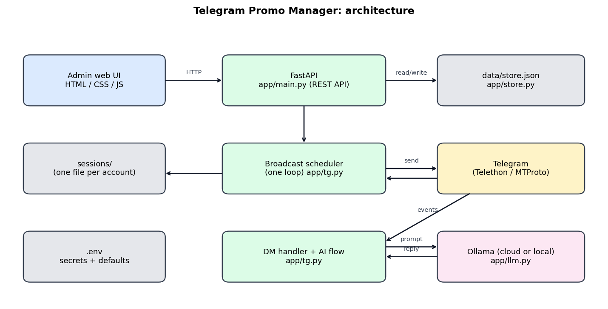
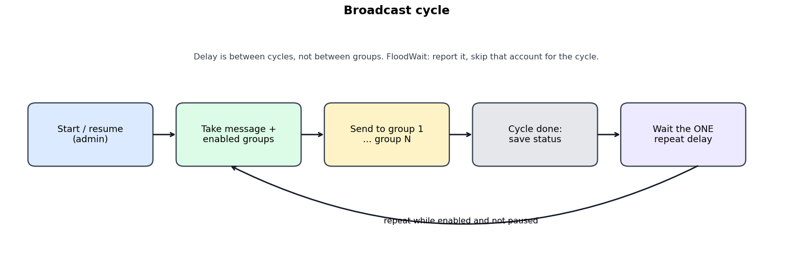
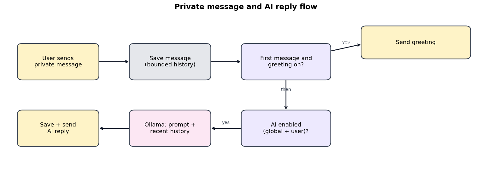

# Telegram Promo Manager

Local-first admin console for Telegram **user-account** automation: schedule one promo message to many groups, and auto-reply to private messages with an Ollama model. Run it on your own computer and manage everything from a web page.



## How it works
- **Broadcast:** you set *one* message, *one* repeat delay (default 10 min, any duration) and a list of destination groups. Each cycle sends to every enabled group, then waits the delay.
- **Private messages:** a new user gets your greeting, then an AI reply built from your system prompt plus bounded recent history. Every conversation is visible in the admin inbox, and AI can be switched off globally or per user.
- **State:** `data/store.json` (state), `.env` (secrets), `sessions/` (Telegram logins). All are gitignored.

| Broadcast cycle | Private message flow |
|---|---|
|  |  |

## Built with
Python · [FastAPI](https://fastapi.tiangolo.com) + Uvicorn · [Telethon](https://docs.telethon.dev) (Telegram MTProto) · [httpx](https://www.python-httpx.org) · [Ollama](https://ollama.com) (`gpt-oss:20b` by default) · Jinja2 · vanilla HTML/CSS/JS · JSON file storage.

## Setup
```
python -m venv .venv && source .venv/bin/activate     # Windows: .venv\Scripts\activate
pip install -r requirements.txt
cp .env.example .env     # fill TG_API_ID, TG_API_HASH (https://my.telegram.org) and OLLAMA_API_KEY
python -m app.main       # open http://127.0.0.1:8000
```
Local Ollama instead of cloud: set `OLLAMA_URL=http://127.0.0.1:11434`, pull a model, leave the key empty. The admin page has *Test connection* and *Test model* buttons. Message text goes to whichever Ollama endpoint you configure.

## Responsible use and security
- Only post where you have permission. Telegram may limit or ban accounts that send unsolicited promotion; the app reports FloodWaits but does not try to evade them.
- There is **no web login**. Keep `HOST=127.0.0.1`; `0.0.0.0` exposes control of your Telegram account to your network.
- Never commit `.env`, `sessions/` or `data/store.json`.

## Contributing
Read [CONTRIBUTING.md](CONTRIBUTING.md) for the code map and dev workflow. Issues and PRs are welcome.

## License and credit
[MIT](LICENSE). You may use, modify and sell this freely, but you must keep the copyright notice. If you build on this project, please credit **[Amaan (@Amaan9136)](https://github.com/Amaan9136)**, for example: *"Based on Telegram Promo Manager by Amaan9136"* in your README, About page or docs.
